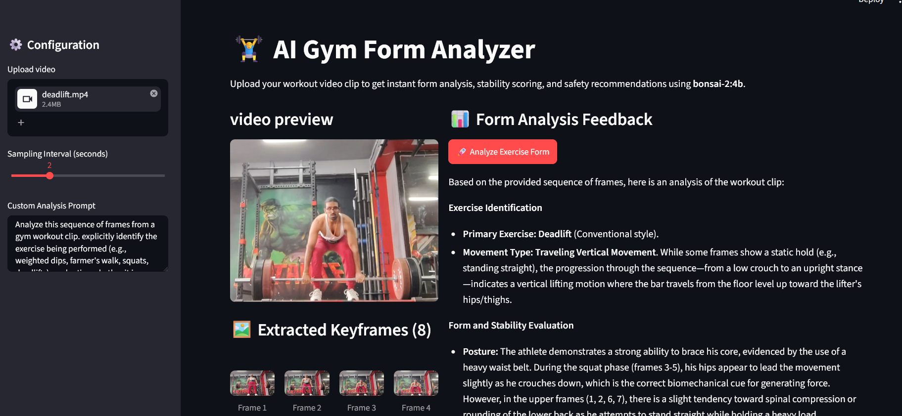
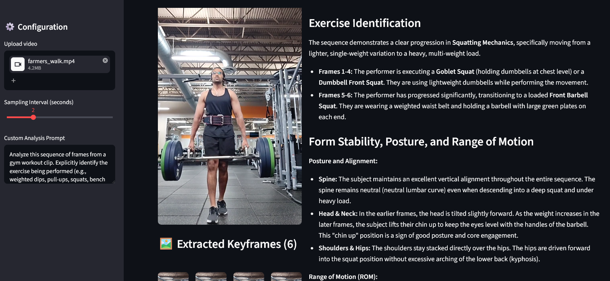

# Results

## Project Summary

This project explores whether a local multimodal LLM can analyze gym exercise form from short videos using a consumer-grade PC setup. The goal was to move beyond benchmark-style datasets and evaluate how a small open-source vision-language model performs on real-world workout footage captured in an uncontrolled environment.

The app was built as a practical edge-AI prototype for gym form analysis, with a Streamlit interface, OpenCV frame extraction, and Ollama-based local multimodal inference.

## Outcome

The project successfully demonstrates that a local multimodal approach can identify many common gym movements and provide form feedback without requiring external cloud APIs. In particular, fixed-axis, structured lifts such as squats and deadlifts were handled much more reliably than dynamic, traveling, or tool-dependent exercises.

## Key Results

### 1. Model progression improved qualitative output

- Prototype model (`moondream-v2`): fast but limited by a smaller context window.
- Production model (`bonsai-2:4b`): much stronger multimodal understanding, larger context, and richer feedback.

This shift improved the quality of exercise interpretation, but also increased inference time and compute demand.

### 2. High-accuracy use cases

The model performed best on exercises with clear biomechanical structure and limited environmental ambiguity, including:

- deadlifts
- squats
- weighted pull-ups

These cases generally allowed the model to reason about:

- hip hinge quality
- lumbar alignment
- depth and posture
- load-related stability cues

### 3. Failure cases exposed context blindness

The most important project finding was that discrete keyframe sampling is not enough for dynamic movement analysis. Some workouts triggered hallucinated interpretations because the model overfit to isolated frames rather than the full movement pattern.

Common failure modes included:

- cable rows mistaken for lunges or banded stretch patterns
- triceps pushdowns mistaken for lat pulldowns
- farmers walks mistaken for vertical squats

These errors were not random; they highlighted a specific limitation: without temporal grounding, the model can anchor to a misleading posture or object and infer a completely different exercise.

## Example Observations

### Correct classification example (Image 3)

A deadlift or squat-like recognition case was successfully interpreted with a coherent explanation of:

- form progression
- posture consistency
- range of motion
- bar path and stance alignment

This is an example of the model performing well when the motion is visually structured and the exercise is biomechanically legible from the sampled frames.

### Misclassification example (Image 4)

A farmers walk clip was incorrectly analyzed as a squat-like pattern. The model appeared to latch onto the vertical body posture and stationary-stage cues while missing the key fact that the movement was traveling through space.

This result is a strong example of spatial/temporal hallucination in multimodal analysis when frame sampling is too sparse.

## Interpretation

The main lesson is that edge AI performance is not just a function of model size. It is also a function of how the model is fed information.

The project showed that:

- stronger multimodal models improve results,
- but context gaps still matter,
- and explicit prompt structure can reduce common false positives.

## Recommendation

The next iteration should focus on hybrid grounding rather than model-only inference. In other words, combine visual context with explicit motion data such as:

- joint angle estimates from MediaPipe or YOLO-pose
- velocity and acceleration signals
- adaptive keyframe selection around movement transitions

This is the most promising direction for making local gym analysis more reliable in real-world use.

## Final Takeaway

Building edge AI is not only about using smaller models. It is about fixing vision context gaps through structured prompt logic, controlled frame selection, and hybrid telemetry to provide the model with movement-aware evidence.
